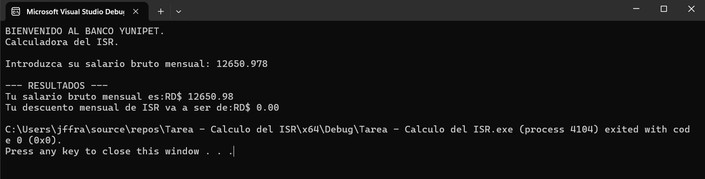
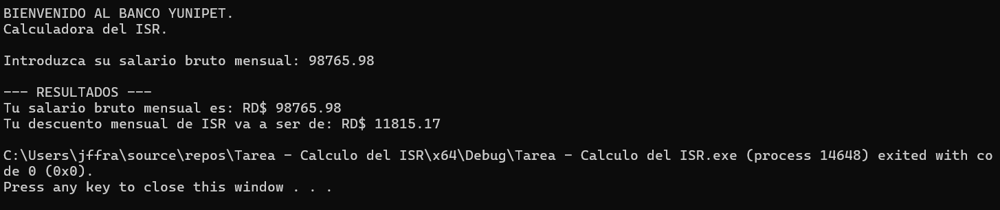
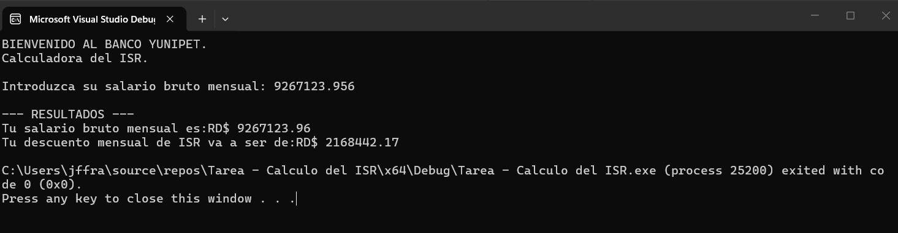

# Programa: Calculadora del Impuesto Sobre la Renta (ISR)

## 1. Datos del estudiante

- **Nombre completo:** Jordany Florentino Franco
- **Matrícula:** 2025-2608

## 2. Descripción breve del programa

Este programa en C++ permite calcular el descuento mensual correspondiente al Impuesto Sobre la Renta (ISR) a partir del salario bruto mensual del usuario. Para realizar el cálculo, descuenta el 5.91% correspondiente a la TSS, determina la renta neta anual y aplica la escala del ISR según el rango de ingresos. Finalmente, muestra el salario bruto y el descuento mensual correspondiente.

## 3. Datos de entrada

- **Salario bruto mensual:** Número decimal que representa el salario mensual del usuario antes de aplicar las deducciones.

## 4. Datos que procesa

- Calcula el 5.91% del salario bruto correspondiente a las deducciones de la TSS (2.87% AFP y 3.04% SFS).
- Resta las deducciones al salario bruto para obtener el sueldo neto gravable mensual.
- Multiplica el sueldo neto gravable por 12 para obtener la renta neta anual.
- Comprueba en cuál de los cuatro rangos establecidos se encuentra la renta neta anual.
- Calcula el ISR anual aplicando el porcentaje correspondiente (15%, 20% o 25%), según el rango.
- Divide el ISR anual entre 12 para obtener el descuento mensual.

## 5. Datos de salida

- **Salario bruto mensual:** Muestra el salario introducido por el usuario.
- **Descuento mensual de ISR:** Muestra el monto que corresponde descontar mensualmente por concepto de ISR. Si no aplica, muestra RD$0.00.

## Capturas del programa en ejecución

### Prueba 1: Salario sin aplicación de ISR

### Prueba 2: Salario con aplicación de ISR

### Prueba 3: Otro salario con la aplicación del ISR

### Prueba 4: Para rentas mayores que 867,123.01.

## 6. Estructuras utilizadas y su función

- **Variables de tipo `double`:** Se utilizan para almacenar el salario bruto, las deducciones, la renta neta anual y los resultados de los cálculos, permitiendo trabajar con números decimales.

- **Estructura condicional `if`, `else if` y `else`:** Permite comparar la renta neta anual con los diferentes rangos del ISR y determinar el impuesto que corresponde pagar según los ingresos del usuario.

- **Estructura secuencial:** Permite ejecutar las instrucciones en orden: solicitar el salario, calcular las deducciones, determinar la renta anual, calcular el ISR y mostrar los resultados.

- **Librería `iostream`:** Se utiliza para solicitar información al usuario mediante `cin` y mostrar los resultados mediante `cout`.

- **Librería `iomanip`:** Se utiliza junto con `fixed` y `setprecision(2)` para mostrar los resultados con dos cifras decimales.
